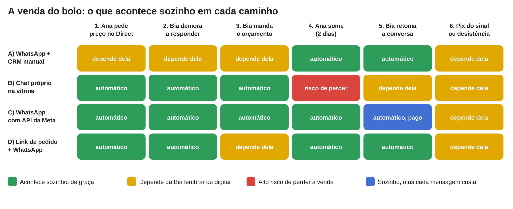

# Pesquisa de mercado: CRM com funil para pequenos negócios

Registro da sessão de validação de negócio. Cada etapa diz o que foi decidido, o que ainda é hipótese e qual é a próxima ação.

Legenda das fontes:

- 🏢 **A empresa anuncia:** página oficial, blog de fornecedor ou pesquisa institucional.
- 🗣️ **Usuários relatam:** reclamações, avaliações e compras feitas por quem usa.
- 💭 **Inferência:** conclusão nossa, que ainda precisa de teste.

## Etapa 1: entrevista inicial (grill-me)

| # | Pergunta | Resposta | O que muda |
|---|---|---|---|
| Q1 | Você tem contatos em algum segmento? | Não | Os primeiros assinantes vão vir de pessoas que não conhecem você. Esse é o primeiro risco a testar. |
| Q2 | Como o produto será oferecido no começo? | Um texto único para qualquer negócio | Em toda resposta, anotar o tipo de negócio, para descobrir qual segmento responde mais. |
| Q3 | Quanto tempo e dinheiro você pode dedicar? | 10 h por semana e até R$ 300 por mês | Começar com abordagem gratuita, por mensagem. Anúncio só depois que o texto provar que funciona. |

Vocabulário fixo:

- **Assinante:** o dono do negócio, que paga o Retoma.
- **Comprador:** o cliente do assinante.

## Etapa 2: como esses negócios vendem hoje

Pesquisa feita em 27/11/2026.

### Limites da pesquisa

- A skill `/last30days` foi instalada, mas o ambiente bloqueia Reddit, YouTube, TikTok e Hacker News, e o pedido para liberar esses sites foi recusado. A busca dela voltou vazia.
- Usamos então busca na web e as páginas oficiais dos produtos.
- Não encontramos relatos diretos de vendedores publicados nos últimos 30 dias. Quase todo o material vem de fornecedores de CRM, de jornais ou do Sebrae.
- **Por isso, ainda falta ouvir os próprios vendedores. As entrevistas da etapa 6 servem para isso.**

### O trabalho real

1. **Por onde chegam os interessados:** principalmente pelo WhatsApp. 82% dos donos de pequenos negócios dizem que o WhatsApp é o principal canal de comunicação e vendas. As lojas virtuais próprias caíram de 14% em 2021 para 10% em 2026. A pesquisa ouviu 8,2 mil empreendedores entre fevereiro e março de 2026. 🏢 [Agência Sebrae](https://agenciasebrae.com.br/dados/whatsapp-se-consolida-nas-vendas-on-line-enquanto-facebook-e-lojas-proprias-perdem-folego/)
2. **Onde o vendedor anota:** em caderno, planilha, agenda impressa ou nas etiquetas do WhatsApp Business. As etiquetas são gratuitas e só o dono da conta vê. 🏢 [Fast Company Brasil](https://fastcompanybrasil.com/tech/10-funcoes-do-whatsapp-business-que-todo-pequeno-negocio-deve-usar/) e [SocialHub](https://www.socialhub.pro/blog/como-criar-etiquetas-organizar-clientes-whatsapp-business/). A Agendor resume assim: existe o funil oficial, no CRM, "atualizado às pressas na sexta-feira", e o funil real, que fica "na lista de conversas do celular do vendedor". 🏢 [Agendor](https://www.agendor.com.br/blog/processo-de-vendas-no-whatsapp/)
3. **Como o vendedor lembra de retomar a conversa:** geralmente de memória. 🏢 [UAI](https://www.uai.com.br/?p=186470)
4. **Quando a venda esfria:**
   - quando a primeira resposta demora;
   - depois que o preço é enviado e o comprador some.

   Exemplo: um pedido de orçamento chega na segunda-feira, recebe uma resposta rápida e, dias depois, está "soterrado por dezenas de outras conversas". 🏢 [Estado de Minas, set/2026](https://www.em.com.br/networking-e-negocios/2026/09/7508723-orcamento-esquecido-no-whatsapp-vira-venda-perdida-em-saloes-e-clinicas.html)
5. **O que já tentaram e pelo que já pagam:**
   - Há produtos pagos para organizar encomendas, como planilhas e agendas para confeiteiras vendidas na Hotmart. 🗣️ [Confeitaria Organizada](https://hotmart.com/pt-br/marketplace/produtos/confeitaria-organizada-controle-de-encomendas/A108344781I) e [Agenda de confeiteira](https://hotmart.com/pt-br/marketplace/produtos/agenda-de-confeiteira-2023-2024/Q78164921Q)
   - Há reclamações sobre cobrança depois do cancelamento e sobre um upgrade de plano forçado em um CRM pago. 🗣️ [Reclame Aqui: Agendor](https://www.reclameaqui.com.br/agendor/retencao-indevida-de-dados-para-forcar-upgrade-de-plano-pratica-abusiva_jHOWrO5RWLUNud0n/)
   - 💭 Não encontramos prova de quanto um vendedor que trabalha sozinho aceita pagar por um CRM. Isso precisa ser perguntado nas entrevistas.

### Modelos que existem hoje

| Modelo | Exemplo | Quem compra | Problema que resolve | Como funciona no dia a dia | Preço público | Por que alguém escolhe |
|---|---|---|---|---|---|---|
| **Grátis** | WhatsApp Business com etiquetas, planilha e memória | Todo mundo | Conversar e vender sem custo | A conversa acontece no WhatsApp. O vendedor marca uma etiqueta e anota no caderno. | R$ 0 | O app já está no celular, e o comprador já está nele. |
| **Funil manual** | [RD Station CRM](https://www.rdstation.com/planos/crm/gratuito/), [Agendor](https://www.agendor.com.br/planos-precos/crm) | Empresas com equipe de vendas | Ver em que etapa está cada negócio | O vendedor cadastra cada negociação e a move entre colunas. | Tem plano grátis. Pago: R$ 59 a 66 por usuário por mês | É uma marca conhecida e dá para começar sem pagar. |
| **Ligado ao WhatsApp e Instagram** | [Kommo](https://www.kommo.com/br/blog/atualizacao-precos-kommo/) | Empresas que atendem muito por mensagem | Fazer as mensagens entrarem sozinhas no funil | A conversa acontece dentro do sistema, pela API da Meta. | US$ 20, 30 ou 45 por usuário por mês, mais US$ 5 desde set/2026 | O vendedor não precisa anotar nada. |
| **Chat próprio no site** | [JivoChat](https://www.eesel.ai/pt/blog/precos-jivochat) | Lojas com site e visitas | Atender quem está no site | Uma janela de chat no site, respondida por um painel. | Tem plano grátis. Pago: US$ 28 a 56 por atendente por mês. WhatsApp é extra. | Serve para quem já tem tráfego no site. |
| **Feito para um segmento** | [Trinks](https://www.softwareadvice.com/salon/trinks-profile) (salões), [Kyte](https://fixthephoto.com/pt/kyte-pos-app-and-system-review.html) (catálogo e caixa) | Donos de salão e de lojas pequenas | Cuidar de agenda e clientes (Trinks) ou de catálogo, pedido e caixa (Kyte) | É o sistema de uso diário do negócio. | Trinks: a partir de R$ 81 por mês (dado de 2023). Kyte: grátis ou a partir de R$ 29,90 por mês. | Fala a língua do negócio e organiza a rotina inteira. |

### O que isso significa para o Retoma

1. 💭 **Uma mensalidade barata disputa com produtos de graça.** RD Station, Agendor e Kyte têm plano gratuito. Um funil genérico, sozinho, não dá motivo para pagar.
2. 💭 **Sem a API da Meta, o sistema não vê as conversas.** Tudo o que entra no Retoma precisa ser digitado pela vendedora, e esse é o maior risco de o produto virar "mais uma tela para preencher". O que ainda funciona de graça:
   - lembretes;
   - links `wa.me` que abrem o WhatsApp com uma mensagem pronta;
   - uma vitrine que já entrega o pedido organizado.
3. 💭 **O chat próprio vai contra o hábito de quem compra.** 72,9% dos consumidores acham que mandar mensagem é mais simples do que navegar em um site. 🏢 [ABC da Comunicação, jun/2026](https://www.abcdacomunicacao.com.br/73-dos-consumidores-preferem-mensagens-e-64-ja-compram-pelo-whatsapp-aponta-pesquisa-da-plataforma/) (fonte secundária). Além disso, o chat próprio exige avisar por e-mail quando o comprador fecha a página.
4. 💭 **A brecha que parece existir:** um vendedor que trabalha sozinho, pelo celular, e precisa lembrar de retomar orçamentos parados, gastando poucos segundos com cada cliente. Os CRMs gratuitos são feitos para equipes de vendas, e o Kyte cuida do catálogo e do caixa. Essa brecha ainda é uma hipótese.

### Resumo da etapa 2

- **Decidido:** o modelo ligado ao WhatsApp e ao Instagram está fora, porque depende da API da Meta. O produto precisa funcionar com um registro manual muito rápido ou com uma vitrine que capture o pedido.
- **Hipóteses a testar:**
  - A dor de esquecer de retomar um orçamento é forte o bastante para alguém pagar.
  - O vendedor aceita registrar cada interessado se isso levar cerca de 10 segundos.
  - O chat próprio vale a pena. As evidências atuais apontam que não.
- **Próxima ação:** na etapa 3, acompanhar a venda de um bolo pelos dois caminhos.

### Revisão da pesquisa do Gemini (/last30days)

O Gemini rodou a `/last30days` sobre o tema "crm sales funnel micro saas", em inglês. Por isso as fontes são principalmente programadores e fundadores de SaaS no Hacker News, no r/SaaS e no r/micro_saas, ou seja, pessoas que **constroem** CRMs, e não donos de pequenos negócios brasileiros que **compram** um.

Checagens feitas no GitHub em 27/11/2026:

| Repositório citado | Estrelas | Licença | Observação |
|---|---|---|---|
| twentyhq/twenty | 61,5 mil | Não padrão (o GitHub não identifica a licença) | O Gemini informou cerca de 45 mil estrelas |
| krayin/laravel-crm | 24,2 mil | MIT | O Gemini informou cerca de 1,1 mil estrelas |
| frappe/crm | 4,0 mil | AGPL-3.0 | |
| espocrm/espocrm | 3,7 mil | AGPL-3.0 | |
| IAbrahanArley/branlycrm | 0 | Nenhuma | Projeto pessoal. Não serve como evidência de mercado |
| kierantrestain/OVELIO | 0 | Nenhuma | Projeto pessoal. Não serve como evidência de mercado |
| openfunnels/openfunnels | Não encontrado | Não se aplica | O repositório não existe ou é privado |

Ideias aproveitadas como hipóteses:

1. Cobrar um **preço fixo por loja**, e não por vendedor.
2. Não enviar e-mails nem mensagens pelo nosso servidor. Em vez disso, usar links `wa.me` e notificações no celular ou no navegador.
3. Registrar o **motivo de perda** de cada venda.

### Segunda rodada da /last30days (27/11/2026, período de 28/10 a 27/11/2026)

- **Fontes que funcionaram:** Reddit (17 tópicos, quase todos do r/empreendedorismo), TikTok (5 vídeos) e Hacker News (12 tópicos).
- **Fontes que falharam:** o YouTube pediu verificação de robô e o Instagram ficou sem chave de acesso.
- **Veredito da ferramenta:** "Nothing solid this window". Nenhum item passou no filtro de relevância.

Leitura manual dos itens:

1. **Não apareceu nenhum vendedor reclamando de orçamento esquecido.** No r/empreendedorismo, quem publica são principalmente pessoas criando negócios ou produtos.
2. **As frases do Hacker News que o Gemini citou vêm de um tópico chamado "Do not build your own CRM" ("Não construa seu próprio CRM").** São comentários de programadores num debate, e não reclamações de clientes. [HN 50485793](https://news.ycombinator.com/item?id=50485793)
3. **Surgiu um concorrente gratuito para quem trabalha sozinho:** o Hermit CRM, um CRM gratuito e de código aberto. [HN 50609708](https://news.ycombinator.com/item?id=50609708)
4. **Um relato brasileiro recente de micro-SaaS de nicho:** um desenvolvedor que trabalha sozinho conta que chegou a 16 assinantes depois de "nichar extremamente forte" em vez de competir com ferramentas genéricas. [r/empreendedorismo](https://www.reddit.com/r/empreendedorismo/comments/1y3ha1w/validei_um_microsaas_de_nicho_narrador_de_ia_para/)
5. **Clientes que param de responder viraram tema de vídeos de vendas,** com pouco alcance. [TikTok](https://www.tiktok.com/@thiagoconcer/video/7709573048021585172)

Conclusão: nos últimos 30 dias, não há evidência pública de que vendedores busquem ou paguem por uma solução para esse problema. Isso não prova que a dor não exista, porque esses vendedores conversam mais no Instagram e em grupos de WhatsApp, que a ferramenta não alcança. A prova precisa vir das entrevistas.

### Terceira rodada da /last30days, com a chave do ScrapeCreators (27/11/2026)

- **Coleta:** TikTok com 12 vídeos, Reddit com 2 tópicos e YouTube com 1 vídeo. O Instagram não trouxe nenhum resultado.
- **Problema nas hashtags:** quase todos os vídeos do TikTok vieram por hashtags genéricas como #vendasonline e #confeitaria, e eram ruído: receitas, anúncios e vídeos da África do Sul.
- **Item útil:** [r/CRMSoftware, 5/11/2026](https://www.reddit.com/r/CRMSoftware/comments/1xoazga/are_businesses_losing_more_revenue_from_missed/). Um usuário conta: "perdemos alguns trabalhos quando nosso orçamentista recebia 40 a 50 mensagens de WhatsApp por dia e perdia o controle de quem pediu o quê; achávamos uma conversa de 3 semanas atrás que tinha morrido no meio". É um relato real, mas de uma empresa estrangeira com equipe, e não de um vendedor que trabalha sozinho.
- **Concorrente brasileiro:** o canal [Rumo CRM](https://www.youtube.com/watch?v=ONZIVbMFvIY) publicou em 27/11/2026 um vídeo sobre "cliente sumiu depois do orçamento". O vídeo teve apenas 2 visualizações.
- **Ajuste para as próximas buscas:** usar busca por palavra-chave sem hashtags genéricas, ou indicar perfis específicos de confeiteiras e lojistas.

### Revisão das 3 buscas do Gemini (confeiteira, lojista do Instagram, etiquetas e planilha)

- O próprio Gemini reconhece que as comunidades não trouxeram evidência suficiente. Tudo o que ele apresenta vem de páginas da web.
- **As fontes são, em sua maioria, empresas que vendem CRM para WhatsApp:** Clint (UseClint), Waseller, Fleap, SocialHub e CuboSuite. Os links levam à página inicial de cada site, e não ao artigo citado.
- **Portal 6:** não encontramos o artigo citado.
- **O rodapé não é o original da ferramenta:** foi editado à mão. Ele traz frases que a ferramenta não gera e um bloco quebrado.

O que aproveitamos:

1. **Como funciona hoje o "CRM improvisado" (descrição feita pelos fornecedores):**
   - nome do contato padronizado (`Ana | Bolo 3kg | Instagram`);
   - etiquetas usadas como etapas da venda;
   - planilha à parte com valor, data do último contato e data do próximo retorno.
2. **Onde esse método falha (também segundo os fornecedores):**
   - a planilha fica desatualizada;
   - as conversas antigas somem no meio das novas;
   - nada avisa quando é hora de retomar um orçamento parado.
3. **Concorrente brasileiro mais caro:** a Clint custa de R$ 523 a R$ 1.177 por mês, inclui a API oficial do WhatsApp e é voltada a infoprodutores. 🏢 [Clint](https://www.clint.digital/blog/crm-custo-beneficio-infoprodutores-whatsapp-2026/)
4. **Novo sinal, do lado do comprador:** há reclamações no Reclame Aqui de clientes ignorados por confeitarias depois de chamar no WhatsApp. 🗣️ [Reclame Aqui](https://www.reclameaqui.com.br/confeitaria-bem-feitus-ltda/empresa-ignora-cliente-apos-contato-via-whatsapp-desconsiderando-a-propaganda-e-adorando-politica-restritiva_T6DqhmRoOQApBvbr/)

## Etapa 3: a venda do bolo acompanhada do início ao fim

Foram comparados quatro caminhos:

- **A)** O atendimento continua no WhatsApp, e a vendedora registra tudo à mão no CRM.
- **B)** O atendimento acontece num chat próprio dentro da vitrine.
- **C)** O atendimento continua no WhatsApp, conectado ao CRM pela API da Meta.
- **D)** O comprador preenche um link de pedido, o pedido vira um cartão no CRM e a conversa segue no WhatsApp.

### Custos e exigências da API da Meta

Levantamento de 27/11/2026. As fontes são provedores de WhatsApp, e os valores divergem entre eles.

- **Cobrança por mensagem desde julho de 2025.** Depois de 24 horas sem resposta do cliente, só é possível enviar modelos de mensagem aprovados pela Meta, e cada um é pago. Os valores informados no Brasil vão de cerca de R$ 0,035 a 0,04 para mensagens de utilidade e de R$ 0,32 a 0,38 para mensagens de marketing. [chatmaxima](https://chatmaxima.com/pt-br/whatsapp-api-pricing/brazil/), [aisensy](https://m.aisensy.com/blog/pt/atualizacao-preco-whatsapp-api-outubro-2026/)
- **Mensagens de atendimento passam a ser cobradas.** A partir de 1/10/2026, as respostas dentro da janela de 24 horas custam a partir da 1.001ª mensagem do mês. Um provedor informa R$ 0,035 por mensagem. [aisensy](https://m.aisensy.com/blog/pt/atualizacao-preco-whatsapp-api-outubro-2026/)
- **Exigências para um SaaS:** ser aprovado como Tech Provider da Meta, manter um servidor de webhooks e usar o Embedded Signup. Cada loja cadastra sua própria forma de pagamento na Meta. A "coexistência" permite que a loja continue usando o app normal do WhatsApp Business no mesmo número. [Meta for Developers](https://developers.facebook.com/documentation/business-messaging/whatsapp/embedded-signup/onboarding-business-app-users)
- **Concorrentes nesse caminho:** Kommo, Clint (de R$ 523 a R$ 1.177 por mês), SocialHub e JivoChat.

### Conclusão da etapa 3

- O produto gera valor em dois momentos:
  - **quando o pedido entra sozinho**;
  - **no dia certo de retomar o contato**, quando a mensagem já aparece pronta.
- O produto vira "mais uma tela" quando a vendedora precisa digitar cada interessado.
- O caminho D resolve a maior parte disso sem a API e sem custo por mensagem. Hipótese a testar: os compradores aceitam preencher o link.

## Ferramenta avaliada: Craft Anything (ArtCraft)

Avaliação de 28/11/2026. Fontes: [página do produto](https://getartcraft.com/apps/craft-anything), [documentação](https://craft.wiki/apps/craft-anything/overview/) e o repositório `storytold/craft-anything`.

- **O que é:** um programa de computador que estuda um site, um aplicativo ou um jogo e depois usa um agente de código, como o Claude Code, para criar uma versão própria. Em seguida, compara essa versão com o original.
- **Situação:** versão alfa inicial (0.6.1). É gratuito e de código aberto, com licença MIT ou Apache-2.0. O repositório foi criado em 31/10/2026 e tem 44,7 mil estrelas.
- **Custos:** o programa é grátis, mas o agente de código é pago à parte, na conta do próprio usuário.
- **Conclusão:** não resolve a dúvida principal do projeto, que é saber se alguém vai pagar. Pode ajudar depois da validação, no modo "clean room", que só observa o que qualquer visitante vê, para estudar o fluxo de telas de vitrines e formulários. Não deve ser usado para copiar concorrentes.
